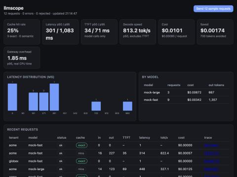

# llm-observability-gateway (`llmscope`)

A small gateway that sits between an application (or an agent) and an LLM and answers the questions you get asked the moment an AI feature reaches production: **how fast is it, what does it cost per request, where did the time and tokens go, and how do I make it cheaper without making it wrong?**

It records **LLM-native metrics** (time-to-first-token, decode tokens/sec, input/output tokens, cost per request), **nested traces** (agent step -> LLM call -> tool call) that can be mirrored to **OpenTelemetry / Cloud Trace**, and it adds the two optimisations that matter most for state management: a **safe response cache** and **conversation-history compaction**. Per-tenant **rate limits and daily budgets** protect the bill.



> **Simulated model, real instrumentation.** The default provider is a deterministic mock whose latency follows `TTFT = base + prefill * input_tokens` and a fixed decode speed, run on a virtual clock so tests and benchmarks take milliseconds. Token counts, cost arithmetic, cache behaviour (including wrong hits), compaction savings and the gateway's own overhead are real measurements; **model latency numbers are simulated** and say nothing about any real model. `GeminiProvider` (streaming, real usage metadata) is implemented but I have not run it against a live project here. The price sheet is illustrative - load current prices from a JSON file.

## What it measures

| Metric | Definition (so there is no ambiguity) |
|---|---|
| `ttft_ms` | request sent -> first streamed token. Includes prefill, which grows with prompt length |
| `tokens_per_sec` | output tokens / (last token - first token): steady decode speed, **excluding** TTFT |
| `cost_usd` | input tokens x input price + output tokens x output price (per-model price sheet) |
| `saved_cost_usd` / `saved_tokens` | what a cache hit or compaction avoided |
| `overhead_ms` | real CPU time the gateway itself added, **excluding** the model call |
| p50 / p95 | nearest-rank percentiles over requests |

## Architecture

```
app / agent ──► POST /v1/chat ──► rate limit ─► daily budget ─► compact history ─► cache ─┐
   │                                                                                       │ miss
   │  with tracer.span("agent.step"):   <── gateway spans nest under the caller's span     ▼
   │                                                                          provider.stream()  (Mock | Gemini)
   ▼                                                                             │ TTFT, tok/s, usage, retries
 SQLite: requests + spans  ◄─────────── cost, saved cost, trace ids  ◄───────────┘
   │            └──► optional OpenTelemetry mirror (gen_ai.* attributes) ──► Cloud Trace / OTLP
   └──► /metrics  /metrics/prometheus  /traces/{id}?tree=true  /dashboard
```

Trace of the 3-step example agent (`examples/agent_demo.py`, full output in `reports/`):

```
agent.run                       7122.8 ms
  agent.plan                    5867.3 ms
    gateway.chat                5867.3 ms  {'model': 'mock-large', 'cache': 'miss', 'input_tokens': 18, 'output_tokens': 242, ...}
      cache.lookup                 0.0 ms
      llm.call                  5867.3 ms  {'ttft_ms': 578.4}
  agent.tool                      40.0 ms
  agent.answer                  1215.5 ms
    gateway.chat                1215.5 ms  {'model': 'mock-fast', 'cache': 'miss', ...}
  agent.answer.retry-from-cache       0.0 ms
    gateway.chat                   0.0 ms  {'cache': 'exact', 'cost_usd': 0.0}
```

## Quick start

```bash
python -m venv .venv && source .venv/bin/activate
pip install -e ".[dev]"          # add ,semantic for real embeddings in the benchmark, ,gemini for Gemini

pytest                           # 32 tests, <1 s
python examples/agent_demo.py    # nested trace of a tiny agent
python -m llmscope.cli bench     # reproduces the tables below
python -m llmscope.cli serve     # http://127.0.0.1:8080/dashboard  (button sends sample traffic)
```

```bash
curl -s localhost:8080/v1/chat -H 'content-type: application/json' -d '{
  "tenant": "acme", "model": "mock-fast", "compact_budget": 1500,
  "messages": [{"role": "user", "content": "What is the refund window?"}]}'
# -> (example shape) {"text": "...", "cache": "miss", "ttft_ms": 34.2, "tokens_per_sec": 813.2, "cost_usd": 0.0000571, "trace_id": "..."}
curl -s 'localhost:8080/traces/<trace_id>?tree=true'
```

Use it as a library, with Gemini and Cloud Trace:

```python
from llmscope import Gateway, ChatRequest, Tracer
from llmscope.cache import ResponseCache
from llmscope.providers import GeminiProvider
from llmscope.tracing import OTelMirror
gw = Gateway(GeminiProvider(project="my-project", vertex=True), cache=ResponseCache())
gw.tracer = Tracer(gw.store, otel=OTelMirror(my_tracer_provider))   # e.g. a provider with the Cloud Trace exporter
```

Environment for the server: `LLMSCOPE_PROVIDER=mock|gemini`, `LLMSCOPE_DB`, `LLMSCOPE_DAILY_BUDGET_USD`, `LLMSCOPE_MOCK_SPEED` (demo server runs the simulated model 10x faster by default).

## Results (simulated model; `reports/benchmark.md`)

### Response cache - 600 requests over 28 intents

The workload mixes exact repeats, near-duplicates (case, punctuation, "Could you tell me ..."), true paraphrases, and **hard negatives**: pairs that differ by one word ("rate limit for the *Business* plan" vs "*Enterprise*", SEV1 vs SEV2, Tier 1 vs Tier 2). A hit is **wrong** if the cached answer was produced for a different intent.

| config | hit rate | wrong hits | cost USD | mean latency ms | gateway overhead p95 ms |
|---|---|---|---|---|---|
| no cache | 0% | - | 0.311 | 1907 | 0.01 |
| exact only | 77.3% | **0** | 0.072 | 441 | 0.01 |
| + semantic >= 0.85, hashing embedder | 87.3% | 2 (0.4% of hits) | 0.040 | 246 | 0.06 |
| + semantic >= 0.9, hashing embedder | 85.2% | 0 | 0.049 | 296 | 0.06 |
| + semantic >= 0.85, **real embeddings** (bge-small) | 95.7% | **65 (11.3% of hits)** | 0.015 | 90 | 3.6 |
| + semantic >= 0.95, real embeddings | 92.2% | 0 | 0.026 | 158 | 3.5 |
| 0.85, real embeddings, **number guard off** | 96.2% | 119 (20.6%) | 0.013 | 82 | 3.5 |

What I take from it:

- **Exact caching is free money: 77% of cost gone with zero wrong answers** (on this deliberately repetitive workload - the absolute rate depends entirely on your traffic).
- **Semantic caching is a correctness risk, not just a tuning knob.** Real sentence embeddings rate "Business plan" and "Enterprise plan" questions as near-identical, so at 0.85 about 1 in 9 hits served the wrong answer. A threshold of 0.95 removed the wrong hits here, but only because this set is small; **calibrate on your own hard negatives** before turning it on.
- **A one-line guard removes a whole failure class.** Refusing a semantic hit when the two prompts contain different numbers cut wrong hits from 119 to 65 at the same threshold (it cannot catch "Business" vs "Enterprise" - that needs entity-aware matching, which I did not build).
- The gateway itself is cheap: p95 overhead is 0.01-0.06 ms for exact/hashing lookups and ~3.5 ms when embedding with a local ONNX model.
- The hashing embedder only catches near-duplicates (that is what it is for); the 8-point hit-rate gap to real embeddings is the paraphrases.

### Context compaction - 20 conversations x 14 turns

| history budget | input tokens | cost USD | TTFT p50 | TTFT p95 | calls compacted |
|---|---|---|---|---|---|
| none | 571,779 (100%) | 0.3075 | 760 ms | 1243 ms | 0/280 |
| 1500 tokens | 248,728 (**44%**) | 0.2106 | 476 ms | 569 ms | 177/280 |
| 800 tokens | 177,340 (**31%**) | 0.1892 | 399 ms | 434 ms | 223/280 |

Input tokens fall by more than half, but **cost falls only ~31-38%** because output tokens dominate the bill at these prices - a good reminder to look at cost per request rather than tokens in. TTFT p95 drops 2.2-2.9x because prefill is proportional to prompt length (a property of the *simulated* model; real models are similar in direction, not in magnitude). **What this benchmark cannot tell you is answer quality**: the summary is extractive and mock answers are random words, so whether compaction hurts correctness is something to measure with your own conversations and an LLM judge.

## What the tests prove (32)

- **Metric maths:** TTFT lies within the profile's bounds and grows with prompt length; tokens/sec matches the decode speed; cost equals the price formula; overhead excludes the model call (a regression test - see below).
- **Cache safety:** tenants, system prompts and models never share entries; sampled (temperature > 0) requests are not cached; multi-turn requests never use semantic matching; TTL expiry and LRU bound; the number guard blocks "30 days" vs "7 days".
- **Guardrails:** token-bucket limiting with refill, per-tenant daily budget that resets next day, retries with one span per attempt, persistent failure -> HTTP 502, all recorded.
- **Tracing:** spans nest under the caller's span through a `ContextVar`; errors mark spans; the OpenTelemetry mirror exports `gen_ai.usage.*` attributes with correct parent/child links and timestamps (tested with the SDK's in-memory exporter).
- **API:** status-code mapping, input validation, Prometheus text, trace tree, dashboard.

## Bugs the tests / the dashboard caught

- `ResponseCache` defines `__len__`, so an **empty cache is falsy** and `if self.cache:` silently disabled caching - the first benchmark showed 0% hits everywhere. Now `is not None`, with a regression test (the test fixture had the same mistake).
- **Gateway overhead showed ~1,000 ms on the dashboard**: I timed the whole request, including the model call, when using a real clock. It now subtracts provider time; regression test uses a 120 ms real-time provider.
- A failed provider attempt that I retried was recorded as an **`ok` span** because the exception was handled inside the `with` block; it is now marked `error`.
- A benchmark-determinism test flaked because it compared real CPU timings. Real timings are now excluded from the comparison.

## Layout

```
src/llmscope/
  gateway.py    call path: limits -> compaction -> cache -> provider -> cost -> records + spans
  providers.py  MockProvider (simulated TTFT/decode), GeminiProvider (streaming + usage)
  tracing.py    nested spans via ContextVar, SQLite sink, OpenTelemetry mirror, tree renderer
  cache.py      exact + semantic response cache, tenant scoping, number guard, TTL/LRU
  context.py    history compaction (extractive summary, pluggable LLM summarizer)
  limits.py     token bucket, daily budget helpers      pricing.py   price sheet + cost
  store.py      SQLite + aggregation (percentiles, histogram)      clock.py   real / virtual clocks
  api.py        FastAPI: /v1/chat /metrics /metrics/prometheus /traces/{id} /requests /dashboard
  bench.py      cache + compaction benchmarks      static/dashboard.html   dependency-free dashboard
tests/ (32)   examples/agent_demo.py   reports/ (benchmark, trace output)
```

## Build log

| Phase | What I did |
|---|---|
| 1. Measurement core | clock abstraction, mock provider with TTFT/decode model, gateway, SQLite store, percentiles |
| 2. Tracing | ContextVar span nesting, tree renderer, OpenTelemetry mirror with GenAI attributes |
| 3. Optimisation | exact + semantic cache with safety rules, history compaction |
| 4. Control + API | rate limit, budgets, retries, FastAPI, Prometheus text, dashboard |
| 5. Benchmarks + fixes | workload with hard negatives, threshold sweep, number guard, the bugs above |

## Limitations / next steps

- Latency is simulated; the first real experiment is pointing it at Gemini on Vertex AI and comparing TTFT and tokens/sec under load.
- `/v1/chat` returns the full response; the provider streams internally (needed for TTFT) but there is no SSE endpoint yet.
- Token counts use ~4 characters per token when the provider does not report usage; Gemini reports real usage.
- The cache and rate limiter are in-process (one replica). A shared store (Memorystore/Redis) is required for horizontal scale; SQLite would become Cloud SQL or BigQuery.
- Entity-aware semantic matching (Business vs Enterprise) is the missing piece for safe semantic caching; until then I would ship exact-only plus a high threshold.
- No auth on the API; the dashboard has no tenant filter.

## License

MIT
